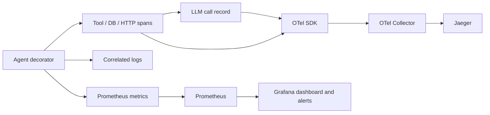

# P03 — Agent Observability

`supportops_obs` instruments Python agent workflows with OpenTelemetry traces, trace-correlated standard-library logs, Prometheus metrics, and deterministic loop detection. Content capture is disabled by default. No LLM calls are required.

## Architecture



## Install and run

Python 3.11 or newer is required. Dependencies are pinned in `pyproject.toml` and `uv.lock`.

```powershell
uv sync --extra dev
$env:LLM_MODE = 'fake'
uv run python demo/runner_double.py
uv run python scripts/check_full.py
```

The demo runner is a local P01 contract double. It does not load P01 code from a sibling folder. P01 package integration is **INCOMPLETE** until a versioned package is built and installed, with version, source commit, and artifact SHA-256 recorded in `docs/harness/sources.lock.json`.

## Instrument a service

```python
from supportops_obs import LLMResponse, record_llm_call, setup_telemetry, traced_agent, traced_operation, traced_tool

setup_telemetry("support-service", otlp_endpoint="http://localhost:4317", capture_content=False)

@traced_tool("ticket.lookup")
def lookup(ticket_id: str):
    return {"ticket_id": ticket_id}

@traced_operation("database", "tickets.read")
def load_ticket(ticket_id: str):
    return lookup(ticket_id)

@traced_agent("support.triage")
def triage(ticket_id: str):
    result = load_ticket(ticket_id)
    record_llm_call(LLMResponse("provider", "model", 35, 12, 0.002, 0.31))
    return result
```

Use `traced_operation("http", "client.request")` for HTTP boundaries. Instrumentation never records function arguments. `record_llm_call` reports caller-supplied token counts, cost, latency and outcome. Model/provider are span attributes; they are deliberately excluded from metric labels to control cardinality. The `gen_ai` convention remains experimental, so the package uses stable OTel APIs and names its own cost/latency attributes. Prompt/output content is attached only after explicit `capture_content=True` and a non-null `content` value.

Use `LoopDetector.observe(StepRecord(...))` at each runner step. It detects repeated tool plus normalized JSON arguments, repeating state cycles, and step-limit overrun. Call `reset()` between runs. Healthy varied paths do not trigger. `record_agent_execution` records steps and task outcome; `record_tool_retry` records retries.

## Local stack

```powershell
docker compose -f stack/docker-compose.obs.yml up -d
```

The stack serves Jaeger at `http://localhost:16686`, Prometheus at `http://localhost:9090`, and Grafana at `http://localhost:3000`. Configure the application OTLP endpoint to `http://localhost:4317`. Start the demo metrics endpoint on port 8000 when deploying a long-running runner; Prometheus scrapes `host.docker.internal:8000`. Stop with:

```powershell
docker compose -f stack/docker-compose.obs.yml down
```

## Dashboard and alerts

Provisioned dashboard: `dashboards/supportops-overview.json`.

| Alert | Default trigger | Investigation |
|---|---|---|
| `AgentLoopDetected` | Any loop signal in five minutes | [Loop runbook](incident-lab/loop-agent.md) |
| `LLMCostAnomaly` | Cost increase above $5 in 15 minutes | [Cost runbook](incident-lab/cost-spike.md) |
| `AgentErrorRateHigh` | LLM error ratio above 10% for five minutes | Inspect error spans and provider outcome |
| `LLMp95LatencyHigh` | LLM p95 over five seconds for five minutes | Follow the slowest child span |

Histogram buckets support p50/p95 queries through `histogram_quantile`; choose SLO thresholds from real service objectives, not these demo defaults. Metric values and real model quality remain **PENDING** until recorded runs exist.

## Incident lab

The three fixtures in `incident-lab/` are deterministic synthetic inputs and are not real traces or model evaluations.

1. **Slow tool:** follow [tool-slow.md](incident-lab/tool-slow.md), compare the tool span with DB/HTTP child spans.
2. **Agent loop:** follow [loop-agent.md](incident-lab/loop-agent.md), inspect repeated tool arguments and state transitions.
3. **Cost spike:** follow [cost-spike.md](incident-lab/cost-spike.md), correlate cumulative cost, tokens, rate and task outcomes.

Run all three model-free scenarios and export synthetic in-memory spans with `uv run python incident-lab/simulate.py`. The JSON output records its synthetic provenance; it is not a production incident export.

Screenshots and exported live traces are **PENDING**. Never attach prompts or arguments unless the privacy decision explicitly allows content capture.

## Validation status

`uv run python scripts/check_full.py` runs unit tests, demo smoke, YAML/JSON validation, Docker Compose config validation when Docker exists, Prometheus rule validation when `promtool` exists, and lock consistency. Its command/exit/output is saved in `artifacts/evidence/check-full.txt`. Unit tests and local in-memory exporter integration are not E2E or agent quality evaluations.
