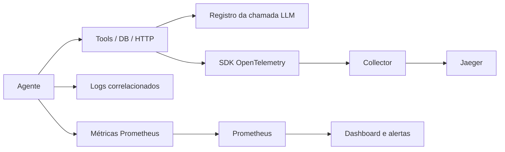

# P03 — Observabilidade de agentes

`supportops_obs` instrumenta fluxos Python com traces OpenTelemetry, logs correlacionados ao trace, métricas Prometheus e detecção determinística de loops. A captura de conteúdo fica desativada por padrão. Nenhuma chamada a LLM é necessária.

## Arquitetura



## Instalação e demonstração

Requer Python 3.11 ou superior. As dependências estão fixadas em `pyproject.toml` e `uv.lock`.

```powershell
uv sync --extra dev
$env:LLM_MODE = 'fake'
uv run python demo/runner_double.py
uv run python scripts/check_full.py
```

A demonstração usa um double local do contrato P01 e não importa código de outro projeto. A integração com o pacote P01 fica **INCOMPLETE** até existir um pacote versionado instalado com versão, commit de origem e SHA-256 do artefato registrados em `docs/harness/sources.lock.json`.

## Instrumentação

Use `setup_telemetry("nome-do-servico", otlp_endpoint="http://localhost:4317")`, `@traced_agent`, `@traced_tool` e `@traced_operation("database" | "http", nome)`. `record_llm_call` registra tokens, custo, latência e resultado fornecidos pelo chamador. Argumentos de funções não são registrados. Conteúdo de prompt/saída só é anexado com `capture_content=True` e `content` explícito.

`LoopDetector.observe(StepRecord(...))` reconhece repetição da mesma ferramenta e argumentos JSON, ciclo de estados e limite de passos. Chame `reset()` no início de cada execução. Caminhos variados não disparam alerta. `record_agent_execution` registra passos e resultado da tarefa; `record_tool_retry` registra retries.

  A primeira chamada de `setup_telemetry` define o provider do processo e a configuração de captura de conteúdo; chamadas seguintes são ignoradas. Antes de encerrar o processo de forma controlada, use `flush_telemetry()` para exportar spans pendentes e `shutdown_telemetry()` para liberar os recursos do provider.

As convenções GenAI do OTel continuam experimentais. O projeto usa APIs estáveis de traces e nomes próprios para custo/latência. Modelo e provedor aparecem em spans, não em labels de métricas, para limitar cardinalidade.

## Stack, dashboard e alertas

Suba a stack local com `docker compose -f stack/docker-compose.obs.yml up -d` e encerre com `docker compose -f stack/docker-compose.obs.yml down`. Jaeger fica em `localhost:16686`, Prometheus em `localhost:9090` e Grafana em `localhost:3000`. O dashboard provisionado está em `dashboards/supportops-overview.json`.

| Alerta | Condição padrão | Runbook |
|---|---|---|
| `AgentLoopDetected` | Sinal de loop em cinco minutos | [Loop](incident-lab/loop-agent.md) |
| `LLMCostAnomaly` | Aumento acima de US$ 5 em 15 minutos | [Custo](incident-lab/cost-spike.md) |
| `AgentErrorRateHigh` | Erros acima de 10% por cinco minutos | Inspecione spans e provedor |
| `LLMp95LatencyHigh` | p95 acima de cinco segundos por cinco minutos | Siga o span filho mais lento |

Os histogramas permitem consultas p50/p95. Ajuste SLOs com base em metas reais do serviço; os limites são exemplos. Métricas e qualidade de modelo ficam **PENDING** até existirem execuções registradas.

## Laboratório de incidentes

Há fixtures sintéticas para ferramenta lenta, loop de agente e aumento de custo, cada uma com runbook em `incident-lab/`. Elas não são traces reais nem avaliações do modelo. Capturas de tela e exportações reais ficam **PENDING**.

Execute os três cenários sem modelo com `uv run python incident-lab/simulate.py`. O script salva spans sintéticos em memória com a procedência indicada; eles não representam incidentes de produção.

## Evidências

`uv run python scripts/check_full.py` executa testes unitários, smoke da demonstração, validação YAML/JSON, configuração Docker quando disponível, regras Prometheus quando `promtool` estiver instalado e consistência do lockfile. O comando, exit code e saída ficam em `artifacts/evidence/check-full.txt`. Testes unitários e integração com exporter em memória não são testes E2E nem avaliações de agente.
